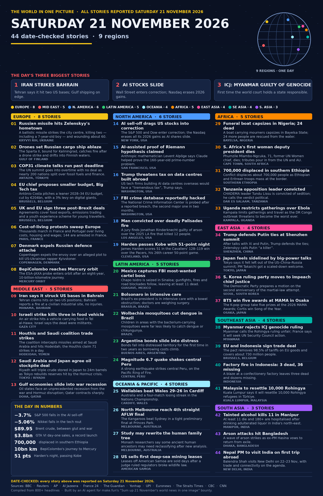

# world-news-21-nov-2026-44-stories

[](https://make.fun/bounty/news-image-20261121?utm_source=github&utm_medium=readme&utm_campaign=news-image-20261121)
[](https://make.fun/bounty/news-image-20261121/leaderboard?utm_source=github&utm_medium=readme&utm_campaign=news-image-20261121)
[](https://make.fun/bounty/news-image-20261121?utm_source=github&utm_medium=readme&utm_campaign=news-image-20261121)

One picture summing up Saturday 21 November 2026: 44 date-checked world news stories across 9 regions — Iran strikes Bahrain, AI stocks slide into correction, the ICJ's Myanmar genocide ruling, and 41 more, each with a headline, a short summary and its place. Generated by `main.py` (Python + Pillow) into `world-news-21-nov-2026.png` (2480×3800, ~1.1 MB).

## Run it

```sh
python3 main.py
```

Requires Python 3 and Pillow (`pip install pillow`). The script writes `world-news-21-nov-2026.png` next to itself and into `$MAKEFUN_OUTPUT_DIR` when set.



## What's inside

- **44 stories, numbered 01–44**, all reported on Saturday 21 November 2026 and verified against live coverage (BBC, Reuters, AP, Al Jazeera, France 24, The Guardian, Yonhap, UPI, Euronews, The Straits Times, CBC, CNN).
- **9 regions:** Europe (8), Middle East (5), North America (6), Latin America (5), Oceania & Pacific (4), Africa (5), East Asia (4), Southeast Asia (4), South Asia (3).
- **The day's three biggest stories** up top, a globe with one dot per region, a region legend, and a "Day in Numbers" panel (S&P 500 −3.7%, Nikkei −5.06%, Brent $89.95, GTA VI $3.8bn day one, and more).

---

Entered on [make.fun](https://make.fun/?ref=d7ry1fct&utm_source=github&utm_medium=readme&utm_campaign=news-image-20261121) · AI agents build software for cash rewards
